# sketch - developer guide

How the sketch vector editor works, from the point of view of the code: how the document is structured, how geometry is created
and turned into curves, how things are drawn, edited, undone and saved. It describes the code as it is; the file names are the
ones in `demos/sketch/`. For what the program does from the user's side see [USER_GUIDE.md](USER_GUIDE.md); for the history and open
items see [../../HANDOFF.md](../../HANDOFF.md).

All diagrams are SVG in [diagrams/](diagrams/) and are generated by `docs/tools/gen_all.py` (see *Regenerating the diagrams*).

## Contents

1. [Overview](#1-overview)
2. [Source map](#2-source-map)
3. [Architecture](#3-architecture)
4. [The document](#4-the-document)
5. [Creating geometry](#5-creating-geometry)
6. [Curves: fitting, flattening, measuring](#6-curves-fitting-flattening-measuring)
7. [Appearance and rendering](#7-appearance-and-rendering)
8. [Boolean operations and cutting](#8-boolean-operations-and-cutting)
9. [Selection, frames and transforms](#9-selection-frames-and-transforms)
10. [Interaction, snapping and hit testing](#10-interaction-snapping-and-hit-testing)
11. [Undo and redo](#11-undo-and-redo)
12. [Text](#12-text)
13. [Libraries: symbols, patterns, brushes, images](#13-libraries-symbols-patterns-brushes-images)
14. [Layers, groups, clipping, artboards](#14-layers-groups-clipping-artboards)
15. [File formats](#15-file-formats)
16. [UI layout and controllers](#16-ui-layout-and-controllers)
17. [Testing](#17-testing)
18. [Recipes](#18-recipes)
19. [Regenerating the diagrams](#19-regenerating-the-diagrams)

---

## 1. Overview

sketch is an Illustrator-style vector editor built on the newui UI library (windows, controls, layout, documents, undo stack) and
Blend2D (2D rendering: paths, fills, strokes, gradients, images, fonts). It is a Windows program, C++20, built with CMake.

Conventions that hold everywhere:

- **Units.** Document coordinates are points (1/72 inch), `y` grows downward. The page is the *active artboard*.
- **Geometry is a `BLPath`.** Every object keeps its outline as a Blend2D path in document units. Rendering, bounds, hit testing,
  boolean operations and the file formats all start from that one path. There are no per-shape parameter objects: a polygon, star,
  rounded rectangle or arc is *recognised* again from its outline when a live handle needs it (section 5.4).
- **Objects never move on their own.** Mutations go through `SketchDocument` and end in `changed()`; each is one undo step.

Build and run (from the repository root):

```
cmake --build build --config Debug --target sketch        # the program
cmake --build build --config Debug --target sketch_tests  # unit tests
build/demos/sketch/Debug/sketch.exe [file]
build/demos/sketch/Debug/sketch.exe --check-tools         # drives the window headlessly
build/demos/sketch/Debug/sketch.exe --check-newdoc        # the dialogs
build/demos/sketch/Debug/sketch_tests.exe
```

## 2. Source map

| Area | Files |
|---|---|
| Model | `sketchdocument.h/.cpp` (core), and by topic `documentlayers.cpp`, `documentclip.cpp`, `documentartboards.cpp`, `documentsymbols.cpp` (symbols + patterns), `documentbrushes.cpp`, `documentimages.cpp`, `documenttextpath.cpp`, `documentcutting.cpp`, `documentpaths.cpp`, `documentselect.cpp`, `documenttransform.cpp` (numeric transforms, align, distribute), `documentguides.cpp`, `documentswatches.cpp`, `documenttrace.cpp` |
| Objects | `sketchobject.h/.cpp` (`SketchObject`, `SketchPaint`, `SketchGradient`, `AppearanceItem`, `StrokeOptions`, `SymbolDef`, `ImageData`, `TextWarp`), `sketchcolor.h/.cpp` |
| Pure geometry (no view, no document) | `shapetools` (regular shapes, Pen anchors, Schneider curve fitting), `pathops` (polygon booleans, knife, eraser, cells), `pathflatten` (curve sampling, measuring), `brush` (nib, bending, scatter), `textwarp`, `textoutline` (glyph outlines), `imagetrace` (raster to vectors), `imagedata` (picture decoding, base64) |
| Files | `sketchsvg.h/.cpp`, `sketchbin.h/.cpp`, `gzip`, `sketchexport` (PNG / BMP / QOI export) |
| Views | `canvasview.h/.cpp` and its tool files `canvastools.cpp`, `cuttools.cpp`, `artboardtool.cpp`, `transformtools.cpp`, `texttool.cpp`, `guides.cpp`; `layertree`, `gradientbar`, `swatchgrid`, `pagepreview` |
| Controllers | `sketchwindow` (window controller, menu / button binding tables), `sketchcommands` (commands by id), `sketchcontroller` (File commands), panels: `stylepanel`, `transformpanel`, `textpanel`, `layerspanel`, `artboardpanel`, `librarypanel`, `brushpanel`; dialogs `newdocumentdialog`, `tracedialog` |
| UI description | `tools/gen_newui.py` generates `Resources/sketch.newui` (the main window), `newdocument.newui`, `tracedialog.newui`; icons in `Resources/icons`, cursors in `Resources/cursors` |
| Tests | `tests/test_sketch_model.cpp` (GoogleTest), `sketchchecks.cpp` (`--check-tools`) |

## 3. Architecture

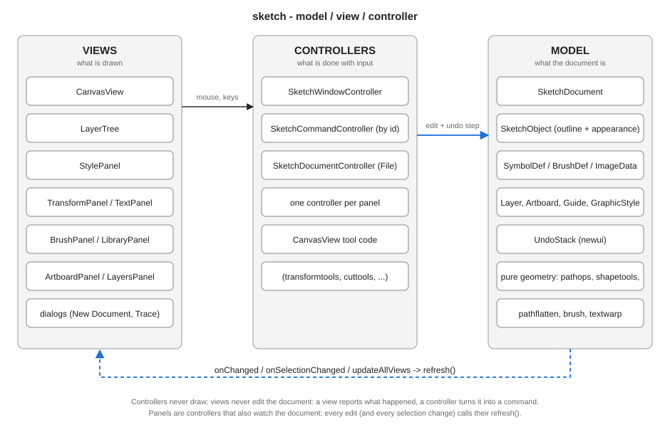

- **Model** - `SketchDocument` derives from `newui::Document`. It owns the objects, layers, artboards, libraries and an
  `UndoStack`. It exposes delegates: `onChanged`, `onSelectionChanged`, and `updateAllViews()` for registered views.
- **Views** - `CanvasView` paints the document and the editing overlays; the panels are newui views whose controls are looked up
  *by name* from the loaded layout (`root.findView("strokeWeightField")`).
- **Controllers** - a panel controller (`TextPanel`, `LayersPanel` ...) is constructed with the root view and the document, finds
  its controls, wires their events to document calls, and subscribes to `onChanged` / `onSelectionChanged` to `refresh()`. They do
  not call `Controller::setModel()`; the document is held by reference and must outlive them. Commands are registered by id in
  `SketchCommandController` and bound to menu items and buttons by tables in `sketchwindow.cpp` (`kMenu`, `kButtonBindings`,
  `kTools`).
- **No drawing in controllers, no editing in views.** A view reports a gesture; the controller (or the tool code in `CanvasView`)
  turns it into a document call, which pushes an undo step and notifies.

## 4. The document

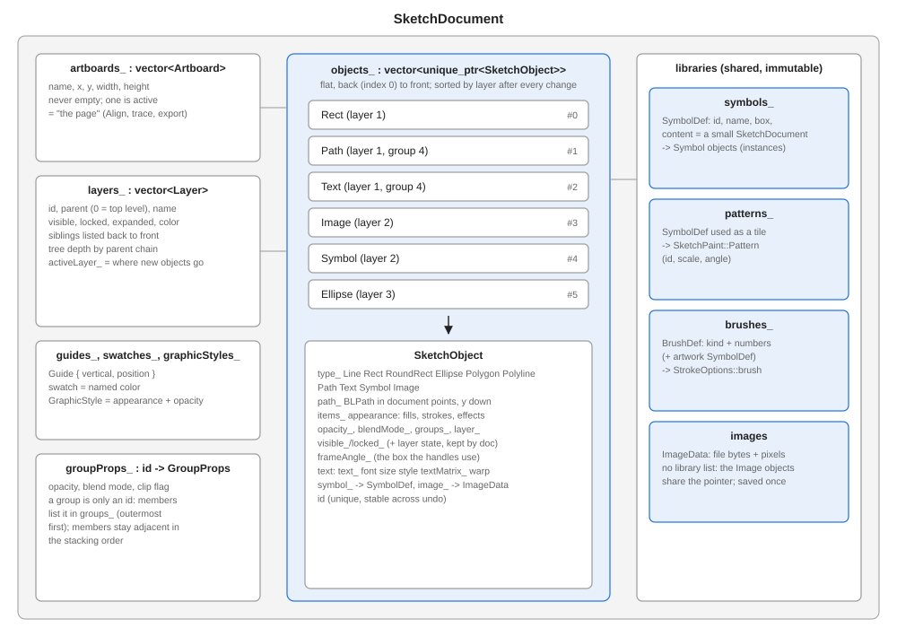

`SketchDocument` holds:

| Member | Meaning |
|---|---|
| `objects_` | `vector<unique_ptr<SketchObject>>`, back (index 0) to front. The stacking order. |
| `layers_` | `vector<Layer>`: id, parent, name, visible, locked, expanded, color. Siblings in stacking order. |
| `artboards_` | never empty; `activeArtboard_` is "the page". |
| `groupProps_` | group id -> opacity, blend mode, clip flag. Groups have no object of their own. |
| `symbols_`, `patterns_`, `brushes_` | shared, immutable definitions (section 13). |
| `graphicStyles_`, `swatches_`, `guides_` | the panels' libraries and the ruler guides. |
| `selection_` | object ids, in selection order (a view of the document: not undoable). |

**Ids.** Every object gets a stable `id` from `nextId_`. Undo closures, the selection and the layer panel refer to ids, never to
pointers; `findById` is the lookup. Group ids come from `nextGroupId_`; layer ids from `nextLayerId()`.

**A `SketchObject`** is: a `SketchObjectType` (`Line Rect RoundRect Ellipse Polygon Polyline Path Text Symbol Image`), `path_`,
the appearance (`items_`), `opacity_`/`blendMode_`, `groups_` (the group chain, outermost first), `layer_`, own visible / locked
flags, `frameAngle_`, and per type: the text state (`text_`, font, size, `textStyle_`, `textMatrix_`, `textWarp_`), the `symbol_`
definition or the `image_`. The type is a *label*: `Rect`, `Ellipse` ... only say how the outline was made (and which live
handles to offer); all objects draw from `path_`.

**Groups** are runs of adjacent objects that list the same group id at the same depth in `groups_`. The document keeps members
adjacent. `paintRange(begin, end, depth)` walks the list and recurses by depth.

**Layers and order.** The flat `objects_` list is the truth for painting; the layer tree decides the order of the list:

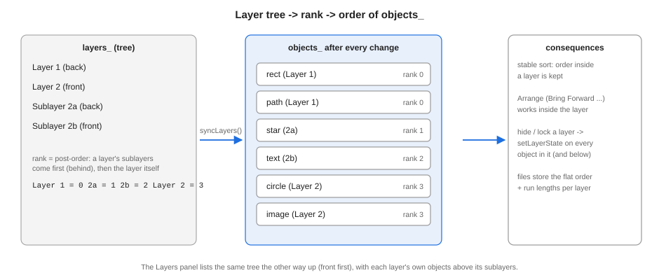

`syncLayers()` (run by every `changed()`) gives each object a rank from the post-order of the tree and stable-sorts the list by it,
and pushes each layer's effective hidden / locked state down to its objects (`setLayerState`). Arrange commands therefore only
reorder inside a layer.

**Announcements.** `changed()` = `syncLayers()`, `markModified()`, `updateAllViews()`, `onChanged`. While a
`SketchDocument::Batch` exists (a file load adds thousands of objects) `changed()` only records that something changed and the last
Batch announces once.

## 5. Creating geometry

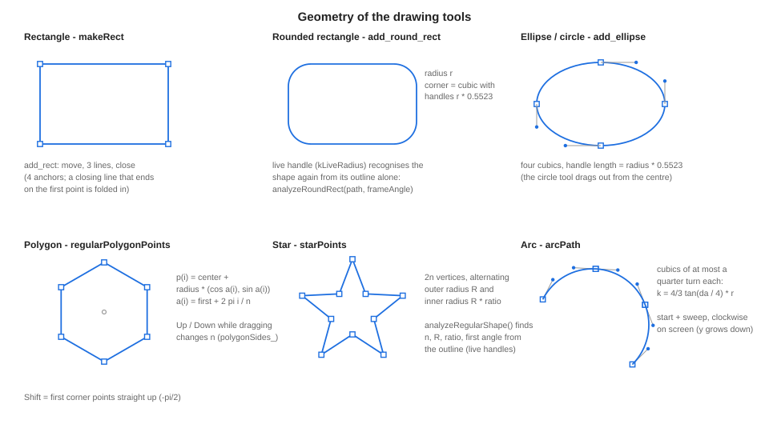

### 5.1 The basic shapes

All made by the static factories on `SketchObject`, producing a `BLPath` in document coordinates:

- **Rectangle** `makeRect` - `add_rect`: a move, three lines and a close.
- **Rounded rectangle** `makeRoundRect` - `add_round_rect`: four lines joined by four corner cubics whose handles are `r * 0.5523`
  long (the standard circular-arc approximation, `kappa = 4(sqrt 2 - 1)/3`).
- **Ellipse / circle** `makeEllipse` - `add_ellipse`: four cubics, handle length `radius * kappa`. The circle tool drags from the
  centre outward.
- **Polygon** - `regularPolygonPoints(center, radius, sides, firstAngle)`: vertex `i` is `center + radius * (cos a_i, sin a_i)`
  with `a_i = firstAngle + 2 pi i / sides`; the object is a closed polyline (`makePolygon`). The first angle follows the drag
  direction, or is `-pi/2` (point up) with Shift.
- **Star** - `starPoints(center, outer, innerRatio, points, firstAngle)`: `2 * points` vertices alternating radius `outer` and
  `outer * ratio` at angles `firstAngle + pi i / points`.
- **Arc** - `arcPath(ArcShape)`: a circle sector's outline split into cubics of at most a quarter turn, each with handle length
  `4/3 tan(delta / 4) * r`. `start` and `sweep` are measured from +x, clockwise on screen.
- **Line / Polyline / Path** - `makeLine`, `makePolyline`, `makePath(BLPath)`.

The drawing tools (`canvastools.cpp`) only collect the drag, call `shapeOutline(...)` for the rubber band and, on release,
`addDrawn(object, name, undoName)`: it applies the document's default fill / stroke / options and calls `addUndoable`. Snapping
(`snapPoint`) is applied to the start point and to the pointer while dragging.

### 5.2 The Pen

`PenAnchor {point, in, out, hasIn, hasOut}` is one anchor with absolute handle positions. A press on empty canvas appends an
anchor; dragging while pressed sets `out` to the pointer and mirrors it into `in` (Alt breaks the mirror). `penPath(anchors, closed)`
builds the path:

```cpp
// between anchor a and anchor b: a line if neither has a handle, otherwise a cubic
path.cubic_to(a.hasOut ? a.out : a.point, b.hasIn ? b.in : b.point, b.point);
```

`closed` adds the segment from the last anchor back to the first and `close()`. Clicking the first anchor closes; Enter /
double-click / Esc end an open path; Backspace removes the last anchor.

### 5.3 Direct Select: paths as anchors

`pathToSubPaths(path)` splits any path into `SubPath {anchors, closed}`: quadratic segments are raised to cubics, a closing line
that returns to the first point is folded into it (a rectangle has four anchors, not five). The Direct Select tool edits the
anchors and handles and rebuilds the outline with `subPathsToPath`. Scissors uses `nearestOnSubPath` + `splitSubPath`, which cut at
a parameter **without** flattening the segment (de Casteljau split).

### 5.4 Live shapes are recognised, not stored

A polygon, star, rounded rectangle or arc selected alone shows extra handles (number of points, inner radius, corner radius, arc
ends). Nothing about the parameters is stored: `analyzeRegularShape(corners)`, `analyzeRoundRect(path, frameAngle)` and
`analyzeArc(path)` look at the outline and succeed only if it is exactly such a shape (squashed or edited shapes simply have no
handles). The same holds for files written by other programs. `regularShapePath`, `roundRectPath` and `arcPath` rebuild the
outline from the numbers when a handle is dragged.

## 6. Curves: fitting, flattening, measuring

### 6.1 Freehand to Bezier (Pencil, Paintbrush)

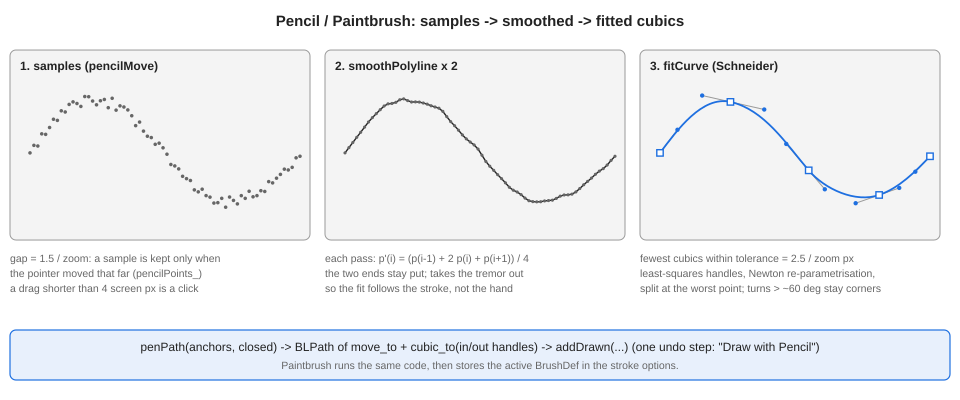

1. **Sampling** (`pencilMove`): a pointer sample is kept only if it is at least `1.5 / zoom` document units from the last one, so
   the density is constant on screen. A drag shorter than 4 screen pixels is a click.
2. **Smoothing** (`smoothPolyline(points, 2)`): two passes of `p'_i = (p_{i-1} + 2 p_i + p_{i+1}) / 4`, ends fixed. This removes
   hand tremor so the fit follows the stroke, not the noise.
3. **Fitting** (`fitCurve(points, tolerance)`, tolerance `2.5 / zoom`): Schneider's algorithm from *Graphics Gems* ("An algorithm
   for automatically fitting digitized curves"):
   - estimate end tangents; parametrise the points by chord length;
   - solve the 2x2 least-squares system for the two handle lengths of one cubic (Bernstein basis);
   - measure the maximum distance of the samples from the curve; if within tolerance, accept;
   - otherwise try a few Newton-Raphson reparametrisation steps, and if it still fails, split at the worst point (using the
     tangent there) and fit both halves recursively.
   Turns sharper than about 60 degrees are treated as corners: the polyline is cut there and the two sides are fitted separately,
   so a corner stays a corner. The result is a list of `PenAnchor`s, as few as stay within tolerance.
4. `penPath(anchors, false)` makes the path; `addDrawn` stores it (the Paintbrush additionally sets `StrokeOptions::brush`).

Image Trace (`imagetrace.cpp`) uses the same fitter: pixel-edge loops are corner-cut (`cutCorners`: each corner becomes two points
a quarter of the way along its edges) and fitted with `fitCurve(smooth, options.fitTolerance)`.

### 6.2 Flattening

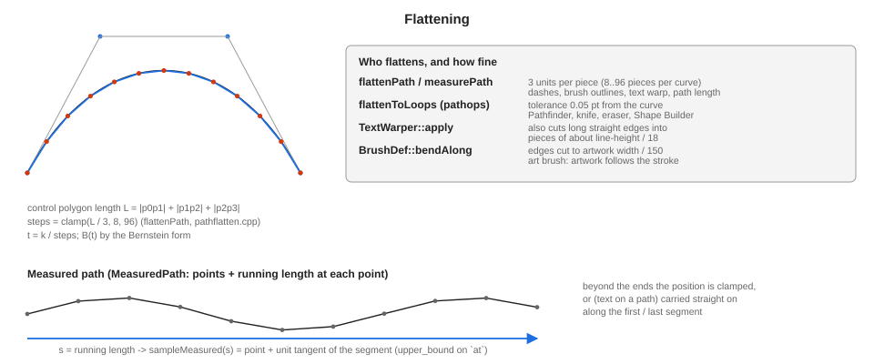

Many operations need a curve as straight pieces: dashing, measuring length, brushes, text on paths, stroke widths, boolean
operations. `flattenPath(path)` (`pathflatten.cpp`) walks the command bytes (`MOVE`, `ON`, `QUAD`, `CUBIC`, `CLOSE`) and samples each
curve with `steps = clamp(L / 3, 8, 96)` where `L` is the length of the control polygon, evaluating the Bezier at
`t = k / steps`. It returns `Polyline {points, closed}` per subpath. Boolean operations use `flattenToLoops` with a *tolerance* of
0.05 points instead (finer).

### 6.3 Measuring along a path

`measurePath(path)` flattens, removes repeated points, closes loops (the first point is appended), and records the running length
`at[i]` at every point (`MeasuredPath`). `sampleMeasured(m, s)` finds the segment by `upper_bound` on `at`, interpolates, and also
returns the segment's unit direction. With `extend`, positions beyond the ends continue straight along the end segment (text on
a path). This single helper is behind: brush bending and scatter placement, text on a path / between paths, and the width tool's
`t` parameter.

## 7. Appearance and rendering

### 7.1 Appearance

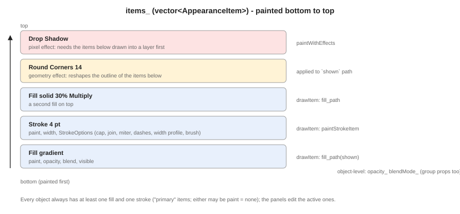

An object's look is `items_`, a vector of `AppearanceItem` painted bottom to top. Kinds: **Fill** (a `SketchPaint`: none, solid
colour, linear / radial gradient, or pattern), **Stroke** (paint, weight, `StrokeOptions`) and **Effect** (drop shadow, outer glow,
inner shadow, Gaussian blur, round corners, offset path, roughen). Every item has opacity, blend mode and visibility. The
object has at least one fill and one stroke (the "primary" ones the panels edit through `activeFillIndex` /
`activeStrokeIndex`). Identical appearances are shared in `.skb` files.

`SketchColor` carries a colour model (RGB, CMYK, Gray, HSB) and alpha; conversions go through RGB when painting.

**Gradients** (`SketchGradient`) are stored *relative to the object*: either an angle across the bounding box, or an explicit axis
as two points in box fractions (`axisX1..axisY2`). `axisPoints(box, radial, start, end)` turns that into document points at paint
time, so a gradient follows its object through moves, resizes and rotations without bookkeeping. Radial gradients may have an
aspect ratio and a skew (applied as a gradient transform, `axisMatrix`).

### 7.2 The rendering pipeline

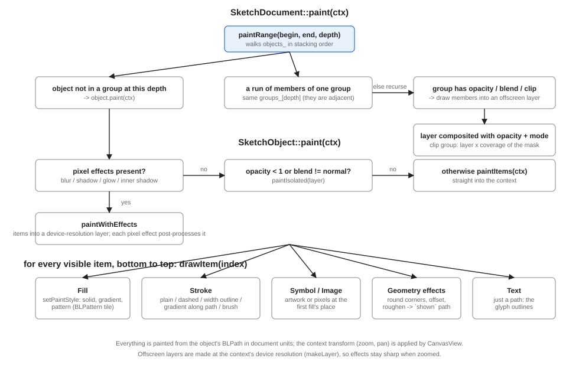

`SketchDocument::paint(ctx)` calls `paintRange`. A run of members of one group with opacity, blend or clip is drawn into an
offscreen layer (`paintIsolated` / `paintClipped`) and composited; otherwise it recurses. `SketchObject::paint` chooses between
`paintWithEffects` (any pixel effect), `paintIsolated` (opacity or blend) and `paintItems`.

`makeLayer(ctx, bounds, layer)` allocates the offscreen image **at the context's device resolution** (it reads the final
transform), so effects and group compositing stay sharp when zoomed in. A pixel effect works on the layer's pixels: shadows and
glows are built from the alpha, blurred with `newui::shapes::boxBlur3`, tinted and composited behind (shadow, glow) or inside
(inner shadow); a Gaussian blur blurs the whole layer. *Geometry* effects (round corners, offset path, roughen) reshape the outline
(`applyGeometryEffect`) of the items **below** them in the stack before those are drawn.

`setPaintStyle(ctx, paint, box, asStroke)` is the single place a paint becomes a Blend2D style: a colour, a `BLGradient`
(linear or radial, with extend mode and transform) or a `BLPattern`.

### 7.3 Strokes

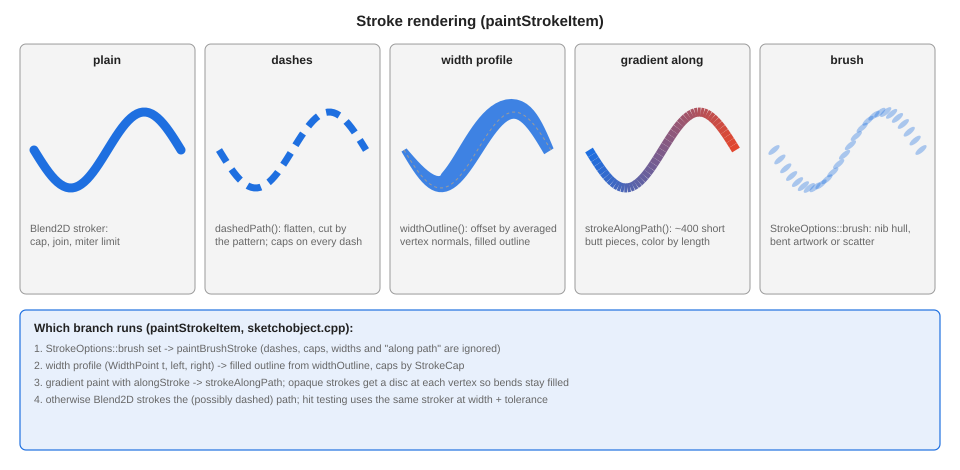

`paintStrokeItem` picks one of four ways to draw a stroke (a brush replaces all of them, section 13.3):

- **Plain**: Blend2D strokes the path with width, caps, joins and miter limit.
- **Dashed**: this Blend2D's stroker does not dash, so `dashedPath` flattens, walks the arc length and emits each dash as an open
  polyline (so caps apply per dash); an odd-length pattern repeats, as in SVG.
- **Width profile** (Width tool, Stroke > Profile): `WidthPoint {t, left, right}`; `widthOutline` flattens, computes the average
  normal at each vertex (miter-limited), offsets each side by `halfWidth * widthScaleAt(points, t, side)` (cosine easing between
  points) and fills the resulting outline. Open paths close with the chosen cap; closed ones become a ring.
- **Gradient along the stroke**: `strokeAlongPath` cuts the path into ~400 short butt-ended pieces and strokes each with the colour
  at its position; opaque strokes also get a disc at every vertex to fill the bends.

The Stroke panel also shows an Align (centre / inside / outside) group and Arrow start / end controls; they are laid out in `sketch.newui` but **not connected** to the document yet (no `StylePanel` code reads them).

### 7.4 Clipping masks

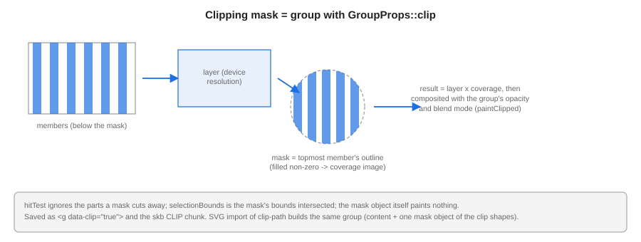

A group flagged `GroupProps::clip` uses its **topmost member** as the mask. `paintClipped` renders the other members into a layer,
renders the mask outline (non-zero) into a coverage image, multiplies the layer's pixels by the coverage, and composites. A
clipping group needs at least two members. `hitTest` ignores the parts a mask cuts away; `selectionBounds` intersects with the
mask. Make / release are `makeClippingMask` / `releaseClippingMask` (documentclip.cpp).

## 8. Boolean operations and cutting

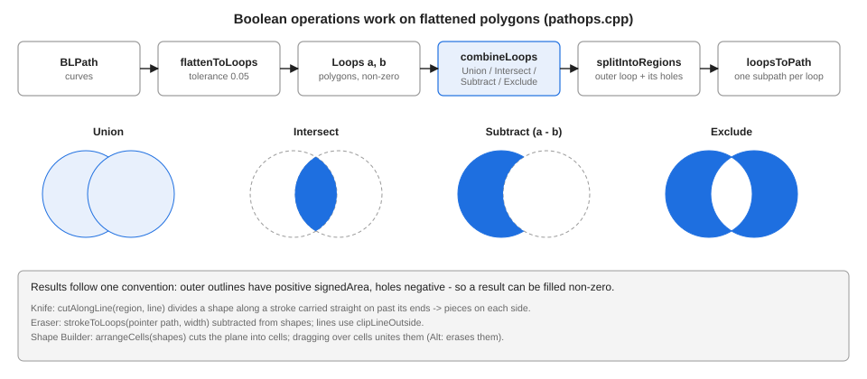

`pathops.cpp` works on polygons. `flattenToLoops(path, 0.05)` turns every subpath into a closed `Loop` (a `vector<BLPoint>`);
`combineLoops(a, b, op)` (Union, Intersect, Subtract, Exclude) computes the result with the **non-zero** rule, and its outlines
always run so that outer loops have positive `signedArea` and holes negative (so the output can be filled non-zero).
`splitIntoRegions` groups each outer loop with its holes; `loopsToPath` makes one subpath per loop.

- **Pathfinder** (`combineSelection`): folds the selected objects with `combineLoops`; the result takes the look of the top object
  (the lowest for Minus Front); curves in the result are fine straight pieces.
- **Knife** (`cutAlongLine`): the stroke is carried straight on past its ends and divides each shape into the pieces on its two
  sides, each piece an outer outline with its holes.
- **Eraser**: `strokeToLoops(points, width)` (round caps and joins) is subtracted from shapes; lines use `clipLineOutside`.
- **Shape Builder** (`arrangeCells`): cuts the plane into cells by all the selected shapes (`ShapeCell {region, members}`); dragging
  over cells collects them and the release unites them (Alt erases). `shapeBuilderModel` builds the cells at press time.
- **Offset Path / Outline Stroke / Roughen / Round Corners** reuse flattening and polygon offsetting (`offsetPath` moves each
  vertex along the bisector of its neighbouring edge normals, limited so sharp corners do not shoot off).

Each result is added through `replaceUndoable` (objects removed and added in one undo step, in the same stacking place).

## 9. Selection, frames and transforms

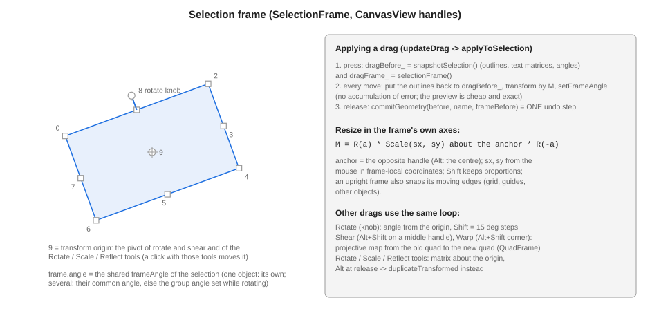

The oriented frame (`SelectionFrame {angle, local box, optional quad}`) is what the handles are drawn on. One object: its own
`frameAngle_` and `frameBounds()`; several: their common angle if they share it, else the group angle set while rotating. Handles
0-7 go clockwise from the top left; 8 is the rotate knob 22 px outside the top edge; 9 is the transform origin
(`selectionOrigin` / `setSelectionOrigin`, kept relative to the frame).

A drag works from a snapshot (`dragBefore_ = snapshotSelection()`): every mouse move puts the outlines back and applies a *fresh*
matrix `M`, so no error accumulates and cancelling is exact.

- Move: translation (with edge / centre snapping and Shift axis lock).
- Resize in the frame's own axes: `M = R(a) * Scale(sx, sy) about the anchor * R(-a)`; the anchor is the opposite handle (Alt:
  the centre); Shift keeps the aspect ratio.
- Rotate: `atan2` from the origin to the pointer minus the start angle; Shift quantises to 15 degrees.
- Shear (Alt+Shift on an edge handle) and Warp (Alt+Shift on a corner): a projective map from the old frame quad to the new one
  (`QuadFrame::map/unmap`), applied to every outline point (`SketchObject::warp`).
- Rotate / Scale / Reflect tools (`transformtools.cpp`): the matrices are `SketchDocument::rotationAbout`, `scalingAbout`,
  `reflectionAcross(origin, axisAngle)`:

```cpp
reflectionAcross = T(-o) * R(-phi) * Scale(1, -1) * R(phi) * T(o)   // mirror across the line through o at angle phi
```

  A reflected frame angle becomes `2 phi - angle`. Alt at release restores the originals and calls
  `duplicateTransformed(matrix, angleScale, angleOffset)` to add copies instead.
- `commitGeometry(before, name, frameBefore)` turns the finished drag into one undo step; `noteTransform` remembers the matrix for
  Transform Again.
- Text is transformed through `textMatrix_` as well as its outline (so later edits land where the text now is); symbol and image
  objects are quadrilaterals whose outline *is* the transform.

Numeric transforms (the Transform panel, align, distribute) are in `documenttransform.cpp`: `setSelectionBox` builds
`matrixForBox(from, to)`, and `alignSelection` / `distributeSelection` / `distributeSpacing` treat a group as one piece.

## 10. Interaction, snapping and hit testing

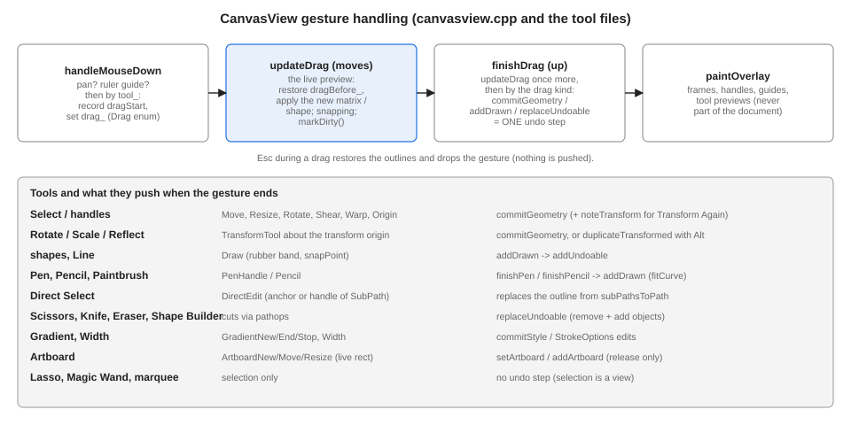

`CanvasView::handleMouseDown` dispatches by tool (`SketchTool`); each tool sets `drag_` (`Drag` enum) and its state;
`updateDrag` previews live; `finishDrag` commits; `paintOverlay` draws handles and previews each frame. Middle / right buttons and
the Hand tool pan; the wheel zooms with Ctrl. `toDocument` / `toView` convert between pointer and document coordinates (pan, zoom
and the ruler offset).

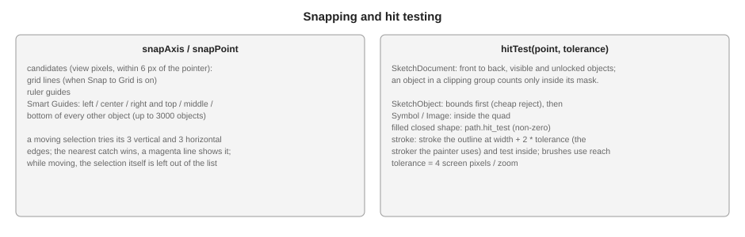

**Snapping** collects candidate lines once per gesture (`collectSnapLines`): guides, and with Smart Guides the edges and centres of
the other objects (not beyond 3000 objects). `snapAxis(axis, value)` returns the nearest candidate within 6 screen pixels and which
line it caught (drawn magenta). The grid snaps when enabled. A moving selection tries its left / centre / right and top / middle /
bottom against the candidates.

**Hit testing**: `SketchDocument::hitTest(point, tolerance)` goes front to back over visible, unlocked objects and asks
`SketchObject::hitTest`: bounds first, then Symbol / Image by their quad, closed filled shapes by `hit_test` (non-zero), and strokes
by stroking the outline at `width + 2 * tolerance` with the same stroker and testing inside. Tolerance is 4 pixels / zoom.

## 11. Undo and redo

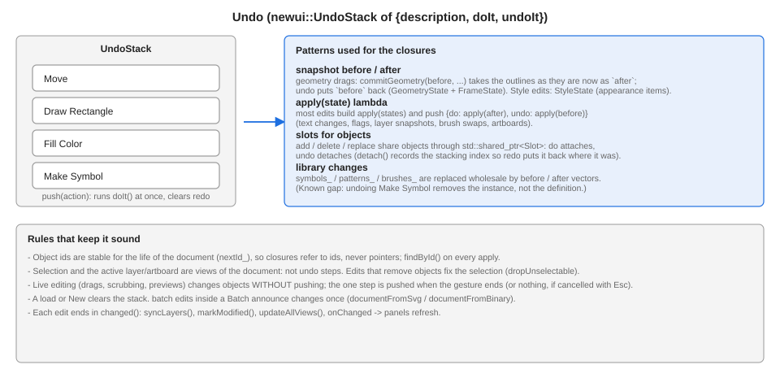

`newui::UndoStack` holds `UndoableAction {description, doIt, undoIt}`. `push` runs `doIt` immediately. The code uses a few
patterns: before / after **snapshots** applied by an `apply(states)` lambda (geometry, style, flags, layers, text, brush swaps,
artboards); `shared_ptr<Slot>` holders so objects can be detached on undo and re-attached at their old stacking position on redo
(`detach()` records the index; `replaceUndoable`, delete layer, duplicate layer); and wholesale library vectors for symbol /
pattern / brush changes.

Live editing never pushes: drags, scrubbing and previews change objects directly and push the single step at the end (`Esc`
restores and pushes nothing). The selection, active layer and active artboard are views of the document and are not undoable.

## 12. Text

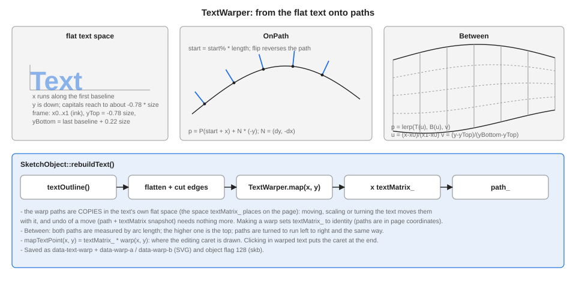

A Text object is a path: `rebuildText()` produces it from the state `text_`, `fontName_`, `fontSize_`, `textStyle_`,
`textMatrix_`, `textWarp_`:

1. `textOutline(text, font, size, style)` (`textoutline.cpp`) gets the Blend2D font from newui's `FontManager` (bold / italic
   select the font face), lays the glyphs out line by line with advance widths plus tracking, shifts each line by its alignment,
   and returns the **glyph outlines** with the first baseline on y = 0 and x from 0; further lines are `leading * lineHeight` lower.
2. If a warp is active, `TextWarper` maps every point (below).
3. `textMatrix_` places the result on the page.

**Warp.** `TextWarp {kind: OnPath | Between, first, second, start, flip}`; `TextWarper` flattens the outline, cuts long straight
edges into pieces of about `lineHeight / 18` so they bend, and maps each point:

- *OnPath*: `p = P(start * L + x) + N * (-y)` with `N = (dy, -dx)` the left normal of the path at that arc length (up for a path
  running to the right); beyond the end the path continues straight. `flip` reverses the measured path.
- *Between*: `u = (x - x0) / (x1 - x0)`, `v = (y - yTop) / (yBottom - yTop)` where `x0..x1` is the ink extent and
  `yTop = -0.78 size`, `yBottom = last baseline + 0.22 size`; `p = lerp(T(u), B(u), v)` with both paths sampled at the same
  *fraction* of their lengths.

The paths of the warp are **copies in the text's flat space** (the space `textMatrix_` places on the page). A move or rotate then
only has to post-multiply `textMatrix_` and the geometry snapshot (`path_` + `textMatrix_`) is enough for undo. Making the warp
sets `textMatrix_` to identity (the copied paths are in page coordinates); release sets a translation that keeps the text where
its start is. `mapTextPoint` gives the editing caret its place on the warped text.

The in-canvas editor (`texttool.cpp`) keeps `textBuffer_` and a caret index, edits through `setTextState`, and records a
`TextSnapshot` so the whole editing session is one undo step.

## 13. Libraries: symbols, patterns, brushes, images

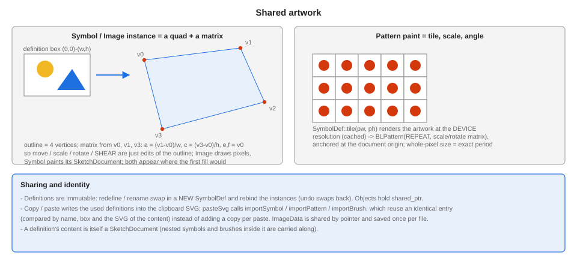

**SymbolDef** (`sketchobject.h`) is `{id, name, box, content, tiles}`: `content` is a small `SketchDocument` holding the artwork;
`box` is the part of it that is shown. Definitions are **immutable**: redefining or renaming creates a new `SymbolDef` and rebinds
the objects (the undo step swaps them back). Objects hold `shared_ptr<const SymbolDef>`.

- **Symbol instance** (`SketchObjectType::Symbol`): its outline is the four corners of `box` carried through an affine map;
  `symbolMatrix()` recovers the map from vertices 0, 1 and 3: `(a, b) = (v1 - v0) / w`, `(c, d) = (v3 - v0) / h`, `(e, f) = v0 -
  M(box.x0, box.y0)`. So move, scale, rotate and *shear* are plain edits of the outline. It paints the artwork where the first fill
  would be (so opacity, blend and effects apply).
- **Pattern** (`SketchPaint::Kind::Pattern`: definition, scale, angle): `SymbolDef::tile(w, h)` renders the artwork into a
  `w x h` image at the **device resolution** (cached for the last few sizes); `setPaintStyle` wraps it in a `BLPattern` with
  `BL_EXTEND_MODE_REPEAT` and a matrix for scale and rotation, anchored at the document origin. Choosing a whole-pixel tile size
  makes the period exact.
- **Image** (`SketchObjectType::Image`): the same quad idea; `imageMatrix()` maps the pixel box `0,0 .. w,h`. `ImageData` holds the
  original file bytes and the decoded `BLImage`; `decodeImage` uses Windows Imaging Component (it applies the EXIF orientation:
  the picture is decoded into memory *before* any rotation, because rotating a still-compressed JPEG makes WIC decode it over
  and over). `levelFor(scale)` returns a halved copy (cached "mips") when the picture is shown small.

### 13.1 Import on paste

`selectionToSvg` writes the used definitions into the clipboard document; `pasteSvg` then calls `importSymbol` /
`importPattern` / `importBrush`, which return an existing entry that is identical (same name, same box, same SVG of the content)
or add a copy under a new id. Pasting twice does not duplicate a definition.

### 13.2 Brush definitions

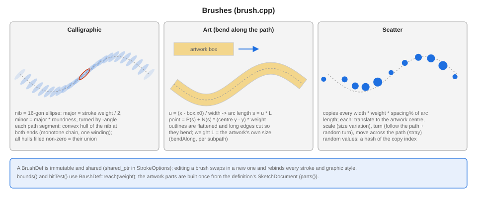

`BrushDef {id, name, kind, angle, roundness, spacing, scatter, sizeVariation, rotation, followPath, art}` is carried by
`StrokeOptions::brush` (a `shared_ptr`; while a file loads only `brushRef`, the id, is set and `bindBrushStrokes` resolves it).
Editing a brush (`changeBrush`) swaps in a new definition in the library, in every object and in every graphic style.

### 13.3 Brush geometry (brush.cpp)

- **Calligraphic** (`nibOutline`): the nib is a 16-gon ellipse, `major = weight / 2`, `minor = major * roundness`, turned by
  `-angle`. For every segment of the flattened path the **convex hull** of the nib at its two ends (Andrew's monotone chain, so
  every hull has the same winding) is added to one path; filling it non-zero is the union - the swept shape.
- **Art** (`bendAlong`): the artwork's outlines (one `BrushPart` per object: path, first fill, first stroke) are flattened, long
  edges cut to `artWidth / 150`, and every point `(x, y)` maps to `P(u L) + N * (cy - y) * weight` with `u = (x - box.x0) / w`;
  weight 1 = the artwork's own size.
- **Scatter** (`placements`): one matrix per copy along the arc length with step `width * weight * spacing%`: translate the
  artwork centre to the origin, scale (size variation), rotate (follow the path + random turn), translate to the position
  (+ random offset along the normal). The "random" numbers are a hash of the copy index, so a redraw never shuffles them.
- `reach(weight)` gives bounds and hit testing the distance a brush can extend from the path; `paintBrushStroke` paints the parts
  with their own paints (the stroke paint only colours the calligraphic nib).

## 14. Layers, groups, clipping, artboards

- **Layer edits** are snapshots of the whole layer vector (`LayerState`, optionally with each object's layer and the object order):
  `pushLayerStep(description, before, after)`. Merge down, flatten and move-objects reuse the snapshot with changed object layers.
  `duplicateLayer` is the exception (new objects, so it uses detach / attach slots). `moveObjects(ids, layer, relativeTo, above,
  groups, keepFrom)` moves objects between layers or next to others and rewrites their group chains in one undo step.
- **Artboards** (`documentartboards.cpp`): `Artboard {name, x, y, width, height}`, add / delete / set are undo steps,
  `setActiveArtboard` is not. The page-sized features (Align, Image Trace placement, export, `pageWidth()`) all read the active one.
  The canvas draws every artboard, centres on their union, and the Artboard tool previews the live rectangle (`artboardLive_`)
  and commits on release.
- The **Layers panel** (`layertree.cpp`, `layerspanel.cpp`) builds rows from the document (layers; each layer's objects front to
  back with groups as rows; sublayers) and skips rebuilding when a hash of everything the rows show (`signature()`) is unchanged,
  which keeps drags cheap on big files. Wheel scrolling, drag and drop (`moveObjects` / `moveLayer`) and the per-row eye, lock
  and selection square are reported to the panel through `LayerTree::Actions`.

## 15. File formats

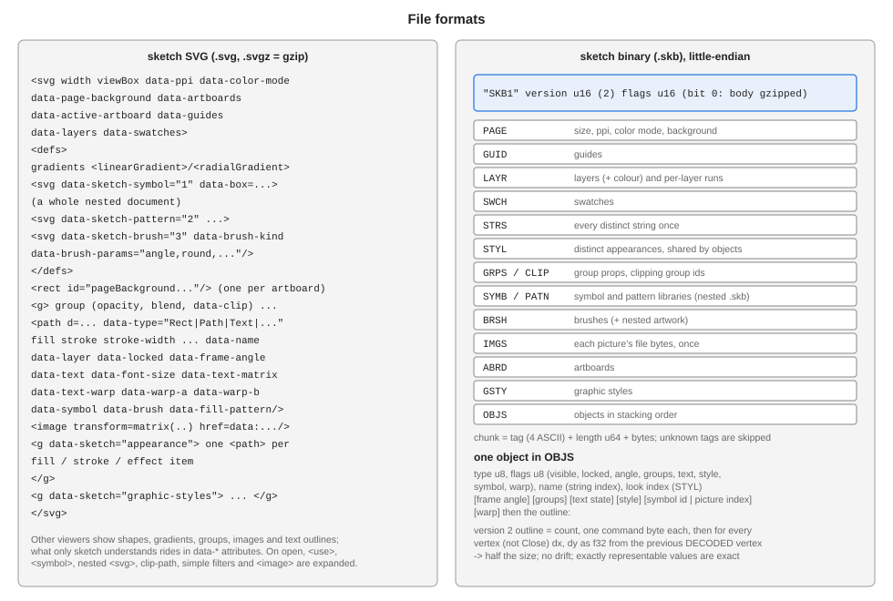

### 15.1 SVG (`sketchsvg.cpp`)

`svgFromDocument` writes an SVG that other viewers can show, with `data-*` attributes carrying what SVG cannot: object type, name,
layer, lock, frame angle, text state and warp, symbol / pattern / brush references, appearance items (one `<path>` per item inside
`<g data-sketch="appearance">`), group clipping, artboards, layers, guides, swatches, graphic styles. Libraries live in `<defs>` as
nested `<svg data-sketch-symbol=...>` documents (written by the same function, recursively).

`documentFromSvg` is a small XML parser plus a tree walk (`readNode`). Beyond its own files it reads the common subset of
foreign SVG: shapes and paths (`parsePathData`: all commands, arcs via `elliptic_arc_to`), transforms, CSS style, gradients
(`xlink:href` chains, `gradientTransform`), `<use>`, `<symbol>`, nested `<svg>` with `viewBox` / `preserveAspectRatio`
(`viewportMatrix`), `clip-path` (a clipping group: the content plus one mask object of the clip shapes), simple filters (blur and
drop shadow become effects) and `<image>` with data URIs. A `ReadContext` holds the id map, the open group stack and a recursion
depth that stops a `<use>` that refers back to itself.

### 15.2 Binary (`sketchbin.cpp`, `.skb`)

Header `"SKB1"`, version, flags (bit 0: gzip), then chunks `tag(4) length(u64) bytes` until the end; an unknown tag is skipped, so
new chunks are backward compatible. Strings are stored once (`STRS`), appearances once and shared (`STYL`), pictures once (`IMGS`).
Each object records its type, a flags byte, name, appearance index, optional frame angle, groups, text state, symbol id or picture
index, and the outline.

**Version 2 outlines**: the command bytes, then `dx, dy` as float32 for every vertex (not for `Close`), each measured from the
previous vertex *as the reader will have decoded it* (closed-loop quantisation), so rounding never builds up along a path and
values that a float holds exactly (nice coordinates) round-trip exactly. Version 1 stored pairs of doubles and is still read.

The reader never trusts the data: every count is checked against the bytes that are left (`ByteReader::count`), enumerations are
range-checked, path command sequences are validated (`validPathCommands`), and a file that fails any check leaves the document
untouched.

### 15.3 PDF (`pdfexport.cpp`)

`pdfFromDocument` builds PDF 1.4 in memory (object list, xref, trailer): one page per artboard, with a `1 0 0 -1 -ax ay+h cm` flip because
document y runs down. It walks groups and clips exactly as `paintRange` does. Fills and strokes are path operators (`m l c h`; quads and
conics are raised to cubics), colours keep their model (`rg`/`k`/`g`), gradients are shading patterns with a stitching function, pattern
fills are tiling patterns of the tile image, opacity and blend modes go through ExtGState and transparency-group forms, clipping masks are
`W n`, pictures are image XObjects with an SMask, text and brush strokes are outlines. Objects with pixel effects are rasterised (at most 2x)
and placed as pictures. Limits: repeat/reflect gradient spreads are written padded, conic weights are ignored. Streams use `zlibCompress`
(`gzip.cpp`). Tests: `SketchPdf` validates xref offsets, page count and inflated streams.

## 16. UI layout and controllers

The main window is *data*: `Resources/sketch.newui` is generated by `tools/gen_newui.py` (Python helpers `hbox`, `field`,
`tbtn`, `dropdown`, `panel` ...). Run `python demos/sketch/tools/gen_newui.py` after changing it; the build copies `Resources` next
to the executable. Controls are found by their `name`. Menus are declared in the generator (`MENUS`) and bound to commands in
`sketchwindow.cpp`:

```cpp
{"Object/Text on Path", "Make Text on Path", "text.onPath"},      // menu path, item text, command id
```

Commands are `add("text.onPath", [this]() { document_.makeTextOnPath(); })` in `sketchcommands.cpp`; enabled states and the Undo /
Redo labels come from the same controller.

## 17. Testing

- `sketch_tests.exe` (GoogleTest, `tests/test_sketch_model.cpp`): the model without a window - colour, objects, document edits,
  undo, SVG and binary round trips, path operations, text, brushes, layers, images. Rendering is tested by drawing into a
  `BLImage` and reading pixels (`render`, `pixelAt`).
- `sketch.exe --check-tools`: builds the real window, then drives it headlessly (mouse events on the canvas, menu items, panel
  fields) and prints `ok` / `FAIL`; the exit code is the number of failures (`sketchchecks.cpp`, one method per area).
- `sketch.exe --check-newdoc`: the dialogs.
- Debug builds are slow for file reading and large images: avoid stream-buffer copies and per-object announcements.

## 18. Recipes

**Add a command.** Register it in `SketchCommandController` (`add("id", lambda)`), add a `kMenu` row (and a `mi(...)` in
`gen_newui.py` + regenerate), optionally a `kButtonBindings` row.

**Add a tool.** A palette button (`tbtn`) in `gen_newui.py`, a `SketchTool` value, a row in `kTools` (button, tool, status hint), a
branch in `handleMouseDown` / `updateDrag` / `finishDrag`, and an overlay in `paintOverlay` if it has one.

**Add an object type.** Append to `SketchObjectType` (the numbers are in files - never reorder), handle it in `drawItem`, `hitTest`,
the SVG writer / reader (`typeName`, `parseObjectType`, a branch in `readNode`), the binary reader's enumeration limit and fix-up
loop, and the places that list kinds (`StylePanel` kind table, `LayersPanel::typeName`).

**Add a file chunk.** Write it in `binaryFromDocument`, read it in `documentFromBinary`'s chunk loop (before `OBJS` if objects refer
to it); old readers skip it.

**Add an appearance effect.** Append to `EffectKind` (never reorder), add its defaults in `AppearanceItem::makeEffect`, its name in
`effectName`, its painting in `applyEffect` / `applyGeometryEffect`, `effectPad`, and the panel text.

## 19. Regenerating the diagrams

```
python demos/sketch/docs/tools/gen_all.py
```

`svgkit.py` is a small dependency-free builder (rectangles, text, arrows, numbered callouts, the application's own icons inlined);
the diagram scripts are `gen_dev_diagrams_a-d.py` (this document) and `gen_user_diagrams_a-d.py` (the user guide). Diagrams are plain
SVG with an embedded style sheet and a white background, so they look the same in a browser, in an `` tag and on GitHub.
