# sketch - user guide

sketch is a vector drawing program: you draw shapes, paths and text, color them, combine and cut them, arrange them in layers and
artboards, and save or export the result. This guide explains every part of the window and how to use it. The illustrations are
diagrams of the real controls (they use the program's own icons). For how it is built, see [DEVELOPER.md](DEVELOPER.md).

## Contents

1. [Quick start](#1-quick-start)
2. [The window](#2-the-window)
3. [Tools](#3-tools)
4. [Working with objects](#4-working-with-objects)
5. [Drawing](#5-drawing)
6. [Transforming and arranging](#6-transforming-and-arranging)
7. [Color, stroke and appearance](#7-color-stroke-and-appearance)
8. [Cutting and combining](#8-cutting-and-combining)
9. [Text](#9-text)
10. [Brushes, symbols, patterns and pictures](#10-brushes-symbols-patterns-and-pictures)
11. [Layers, clipping masks and artboards](#11-layers-clipping-masks-and-artboards)
12. [Rulers, guides, grid and snapping](#12-rulers-guides-grid-and-snapping)
13. [Files and export](#13-files-and-export)
14. [Keyboard and mouse reference](#14-keyboard-and-mouse-reference)
15. [Not there yet](#15-not-there-yet)

---

## 1. Quick start

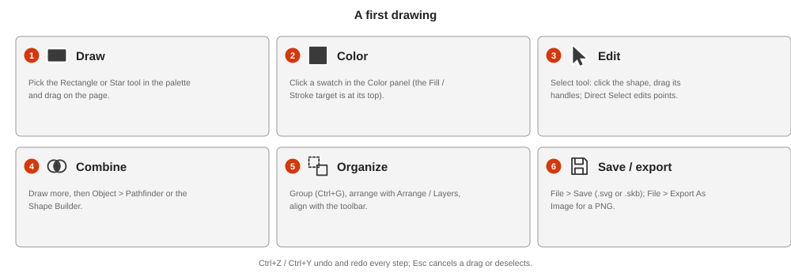

1. **File > New** chooses a page size (Print, Web, Mobile, Art presets, or your own size and color mode).
2. Pick a shape tool and **drag** on the page.
3. Click a color in the **Color** panel. Which one it changes - the fill or the stroke - is chosen by clicking the fill or stroke **well** at the bottom of the tool palette (or the words Fill / Stroke at the top of the panel).
4. Switch to the **Select** tool (the arrow, top left of the palette) to move and resize.
5. **Ctrl+S** saves; **File > Export As Image** writes a PNG.

`Ctrl+Z` undoes and `Ctrl+Y` redoes, as many steps as you like. **Esc** cancels a drag that is in progress.

The **File > Open** dialog also opens the example `docs/examples/showcase.svg`, which uses most of the features described here.

## 2. The window

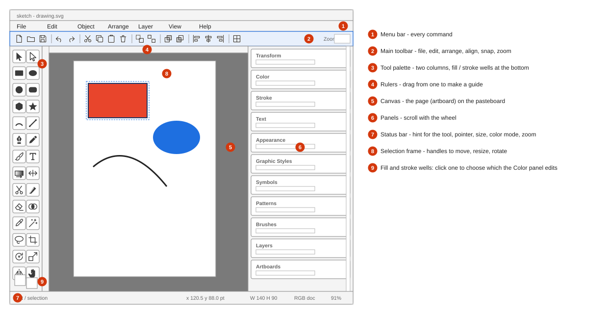

| # | Part | What it is for |
|---|---|---|
| 1 | Menu bar | Every command: File, Edit, Object, Arrange, Layer, View, Help. |
| 2 | Main toolbar | New, Open, Save, Undo, Redo, Cut, Copy, Paste, Delete, Group, Ungroup, To Front / To Back, Align (left, center, right), Snap to Grid, and the Zoom box. |
| 3 | Tool palette | Pick a tool; the fill and stroke color wells are at the bottom. |
| 4 | Rulers | Show points from the page's top left corner; drag out of a ruler to make a guide. |
| 5 | Canvas | The page (artboard, white) on the dark pasteboard. Everything outside the page still exists and is saved. |
| 6 | Panels | Transform, Color, Stroke, Text, Appearance, Graphic Styles, Symbols, Patterns, Brushes, Layers, Artboards. Scroll the column with the mouse wheel. |
| 7 | Status bar | A hint for the tool in use or what is selected; the pointer position, size of the selection, the document's color mode and the zoom. |
| 8 | Selection frame | Appears round whatever is selected (section 4). |

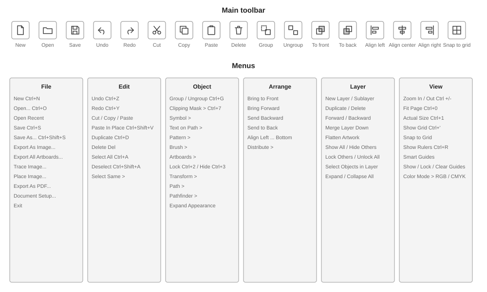

The toolbar buttons are shortcuts for menu commands (the same commands, so they are disabled together). Menu items show their
keyboard shortcut at the right.

**Viewing.** The wheel scrolls up and down, Shift+wheel scrolls sideways, Ctrl+wheel zooms about the pointer. The middle or right
mouse button drags the page; so does the Hand tool. The Zoom box in the toolbar and *View > Zoom In / Zoom Out / Fit Page / Actual
Size* (Ctrl+`+`, Ctrl+`-`, Ctrl+0, Ctrl+1) set the zoom; *Fit Page* shows all the artboards.

## 3. Tools

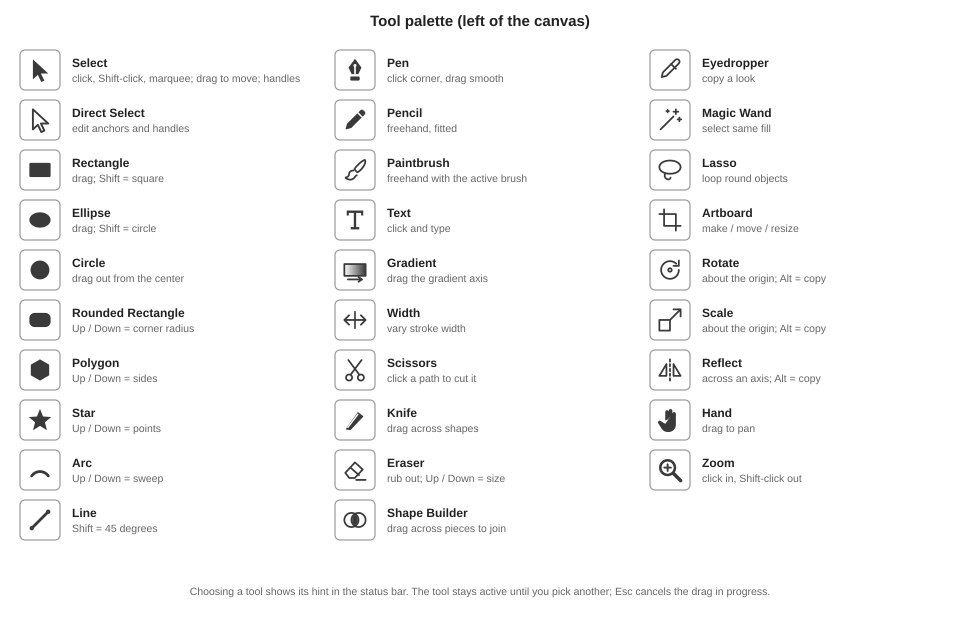

Click a tool to use it; the status bar tells you what it does. Tools are described where they are used:
drawing (section 5), transforming (6), gradient and width (7), cutting (8), text (9), the Paintbrush (10), the Artboard tool (11).

## 4. Working with objects

### Selecting

With the **Select** tool: click an object; **Shift+click** adds or removes it; drag on empty canvas for a **marquee** (everything
the box touches); **Ctrl+A** selects all, **Ctrl+Shift+A** or **Esc** deselects. Clicking an object that is in a group selects the
whole group; **Ctrl+click** picks one object of the group.

Other ways to select: the **Magic Wand** (click an object: everything with the same fill), the **Lasso** (drag a loop round
objects; Shift adds), **Edit > Select Same** (fill color, stroke color, stroke weight, opacity, blend mode, object type), and the
square at the right of a row in the **Layers** panel.

### The selection frame

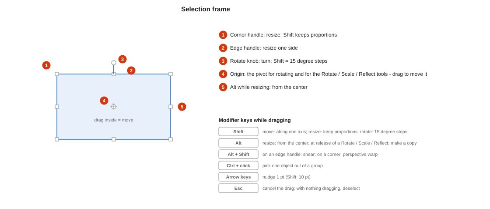

Drag inside the frame to **move** (Shift keeps to one direction), a corner or edge handle to **resize**, the round knob above the
top edge to **rotate**. The small circle in the middle is the **origin**: the pivot of rotating and shearing, and of the Rotate,
Scale and Reflect tools; drag it to move the pivot. Arrow keys nudge by 1 point (Shift: 10). *Object > Transform > Reset Bounding
Box* (Ctrl+Shift+B) makes the frame upright again.

The numbers in the **Transform** panel (X, Y, W, H, Angle) show the selection and change it when you type a value and press Enter.
You can also **drag the captions** (the letters X, W, Angle ...) left and right to scrub the number: one unit a pixel, Shift for
tenths, Ctrl+Shift for hundredths. The whole drag is a single undo step.

### Copy, paste, duplicate, delete

**Ctrl+X / Ctrl+C / Ctrl+V** use the system clipboard (as SVG text, so you can paste into another sketch window or a text editor).
**Ctrl+Shift+V** pastes in the same place; **Ctrl+D** duplicates with a small offset; **Delete** removes the selection.

### Groups, lock, hide, stacking

**Ctrl+G** groups the selection (an object can be in groups inside groups); **Ctrl+Shift+G** ungroups. **Ctrl+2** locks and
**Ctrl+3** hides the selection; *Object > Unlock All* and *Show All* bring everything back. The **Arrange** menu brings objects
forward and backward (**Ctrl+]**, **Ctrl+[**; with Shift to the very front or back). Stacking order works inside a layer.

## 5. Drawing

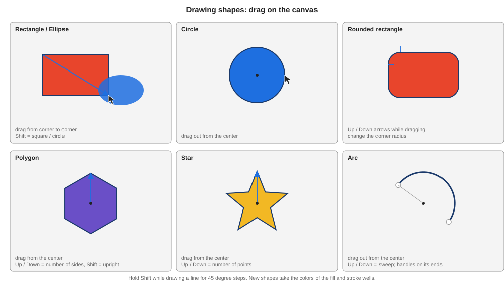

**Shapes**: Rectangle, Ellipse, Circle, Rounded Rectangle, Polygon, Star, Arc and Line are all drag-to-draw. While the button is
down: **Shift** constrains (square, circle, upright, 45 degrees); **Up / Down** arrows change the number of sides or points, the
corner radius or the arc's sweep. A selected polygon, star, rounded rectangle or arc shows round **live handles** you can drag to
change those numbers afterwards.

New shapes are drawn with the document's current fill and stroke (shown in the two color wells at the bottom of the tool palette when
nothing is selected) and its stroke weight.

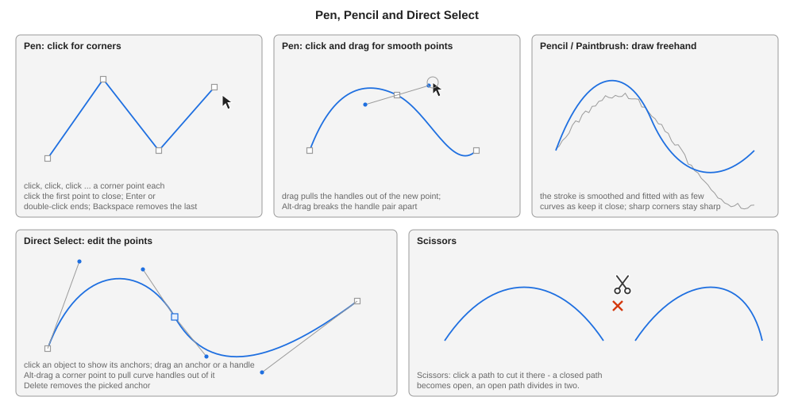

**Pen**: click for a corner point; click and drag for a smooth point (the drag pulls out the curve handles; hold **Alt** to break the
handle in two). Click the first point to close the path; **Enter**, **double-click** or **Esc** finish an open path; **Backspace**
removes the last point.

**Pencil** and **Paintbrush**: drag freehand. When you let go the line is smoothed and replaced by the fewest smooth curves that
follow it closely; sharp corners stay sharp. The Paintbrush uses the active brush (section 10).

**Direct Select** shows the points of the clicked object: drag a point or a curve handle; **Alt-drag a corner point** to pull curve
handles out of it; **Delete** removes the picked point. **Scissors**: click a path to cut it there. *Object > Path* has
**Join**, **Reverse Direction**, **Simplify** and **Outline Stroke**.

## 6. Transforming and arranging

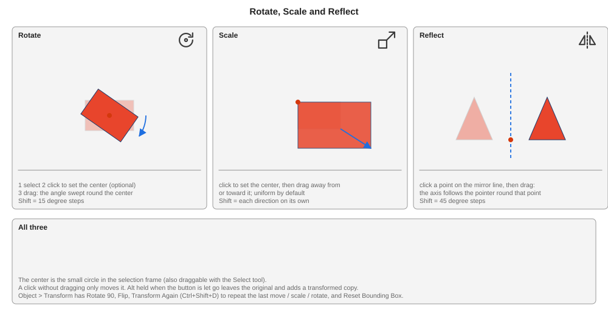

The **Rotate**, **Scale** and **Reflect** tools work on the selection about its *origin*. Click once to put the origin where you
want it (the center by default), then drag anywhere:

- **Rotate** turns by the angle you sweep round the origin (Shift: 15 degree steps).
- **Scale** grows or shrinks by how far you move from the origin, in proportion (Shift: width and height independently).
- **Reflect** mirrors across a line through the origin that follows the pointer (Shift: 45 degree steps).
- Hold **Alt** when you let go to keep the original and make a transformed **copy** instead.

*Object > Transform*: **Transform Again** (Ctrl+Shift+D) repeats the last move, scale or rotate on whatever is selected now;
Rotate 90 CW / CCW; Flip Horizontal / Vertical.

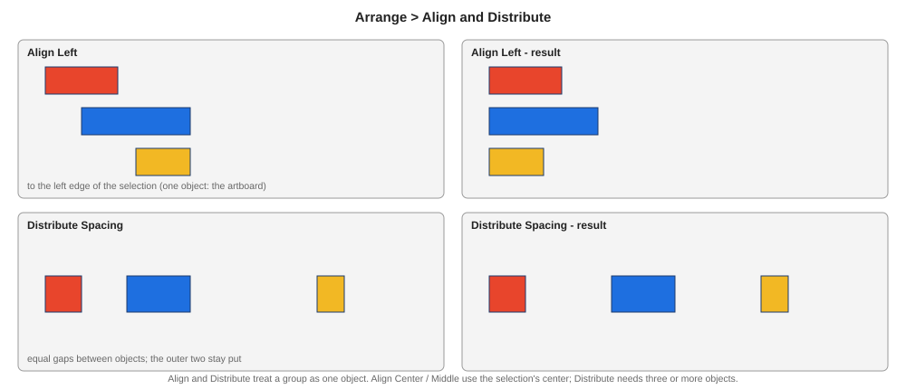

**Arrange > Align** lines objects up to the left, center, right, top, middle or bottom of the selection - or, with a single object
selected, of the page. **Arrange > Distribute** spreads three or more objects: *Left Edges ... Bottom Edges* make the chosen edge
or center evenly spaced between the outermost two; *Horizontal / Vertical Spacing* make the gaps equal. A group counts as one
object.

## 7. Color, stroke and appearance

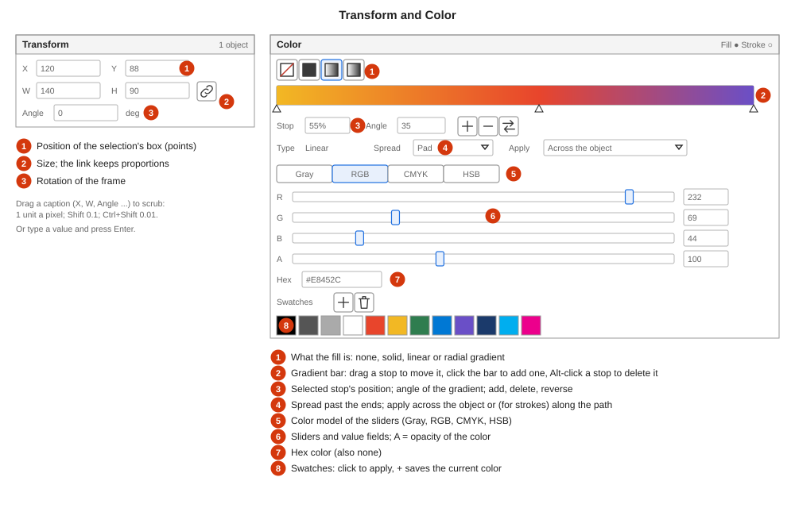

The **Color** panel edits either the *fill* or the *stroke*: click the fill or stroke well at the bottom of the tool palette, or the words Fill / Stroke at the top right of the panel, to choose. Choose
*none*, a *solid color*, a *linear gradient* or a *radial gradient*. The sliders follow the color model you pick (Gray, RGB, CMYK,
HSB); a document in CMYK mode converts. Swatches are saved with the document.

**Gradients.** The gradient bar shows the stops: drag a stop to move it, click the bar to add one, **Alt-click** a stop to delete
it, and edit the selected stop's color with the sliders. *Spread* chooses what happens past the ends (pad, repeat, reflect).
*Apply* either runs the gradient across the object or - for a stroke - along the path.

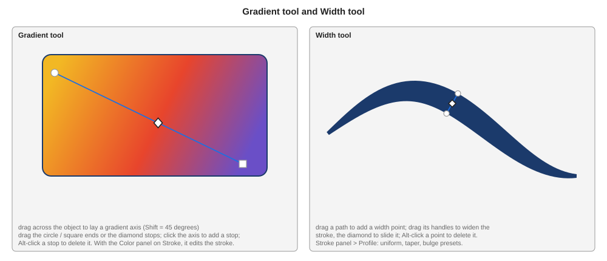

The **Gradient** tool draws the gradient directly: drag across an object to lay the axis; drag its ends or stops to adjust (the
circle is the start or center, the square the end). The **Width** tool varies a stroke's thickness: drag along a path to add a
point, drag its handles to widen, the diamond to slide it, **Alt-click** a point to delete it. The **Eyedropper** copies the look
(fill, stroke, effects) of a clicked object onto the selection.

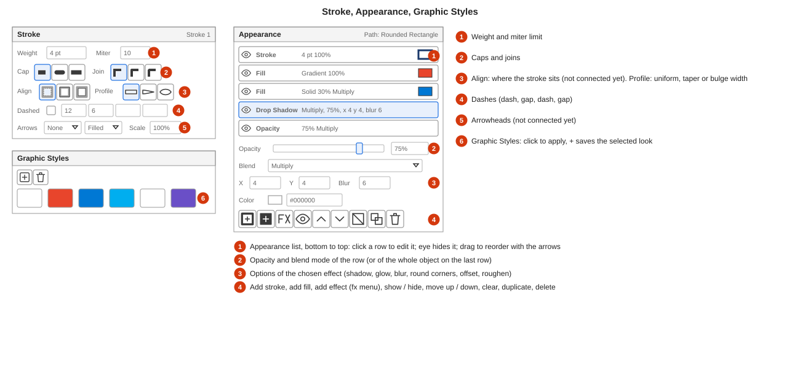

**Stroke** panel: weight, miter limit, cap and join styles, dashes (tick *Dashed* and give dash and gap lengths) and the width
profile (uniform, taper, bulge). *Align* puts the stroke of a closed shape centred on the outline, wholly inside it or wholly outside it. *Arrows* put a head (Simple, Filled or Dot) on the start and end of an open path; *Scale* sizes them as a percentage (100% is four stroke weights long). Neither applies to brush strokes.

**Appearance** panel: an object can have several fills, strokes and *effects*, drawn bottom to top as listed (the top row is on
top). Click a row to edit it; the eye hides it; the arrows reorder; the buttons add a stroke, fill or effect (the **fx** menu), clear,
duplicate and delete. Each row has its own opacity and blend mode; the last row, **Opacity**, is for the whole object. Effects:
**Drop Shadow, Outer Glow, Inner Shadow, Gaussian Blur** (these work on pixels and act on everything below them in the list) and
**Round Corners, Offset Path, Roughen** (these reshape the outline). *Object > Expand Appearance* turns a complex appearance into
plain objects (strokes become filled outlines, brush strokes their artwork, shadows and blurs a picture).

**Graphic Styles** save a whole appearance: click **+** to save the selected object's look, click a swatch to apply it.

## 8. Cutting and combining

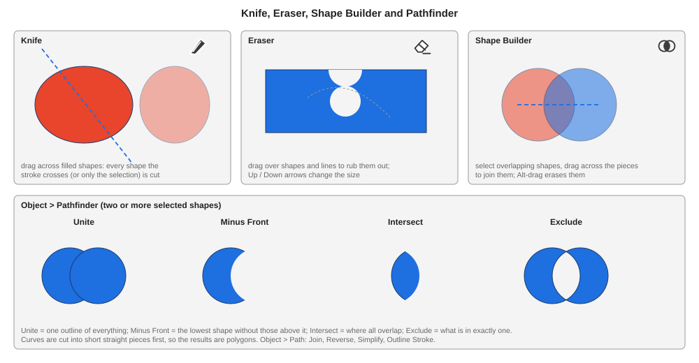

- **Knife**: drag across filled shapes to cut them into pieces (all the shapes under the stroke, or only the selected ones).
- **Eraser**: drag over shapes and lines to rub them out; **Up / Down** change the size.
- **Shape Builder**: select overlapping shapes, then drag across the pieces you want to join into one shape; **Alt-drag** erases
  the pieces you cross.
- **Object > Pathfinder** (two or more shapes): **Unite**, **Minus Front**, **Intersect**, **Exclude**.

These tools turn curves into fine straight segments before cutting, so the results are polygons (very finely cut).

## 9. Text

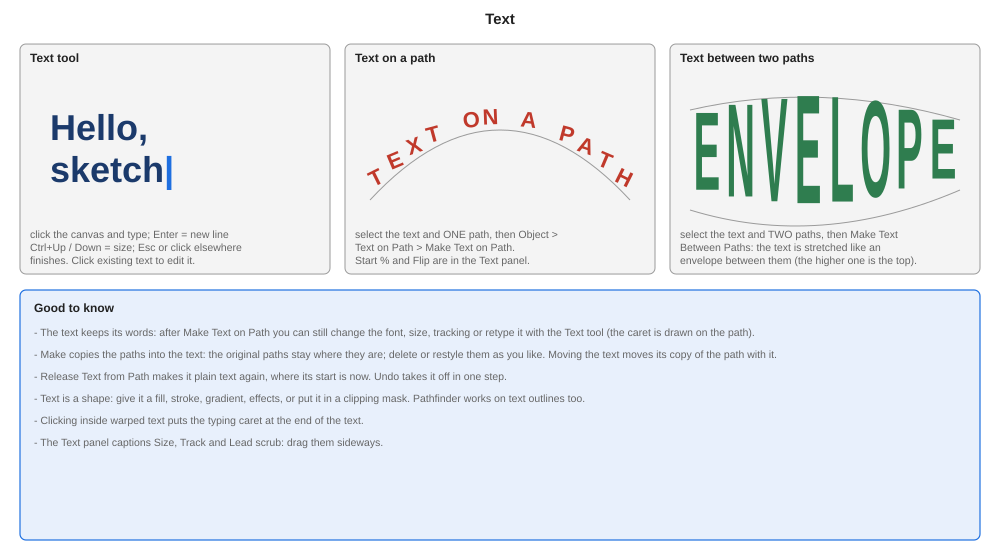

The **Text** tool: click the canvas and type; Enter starts a new line; **Ctrl+Up / Ctrl+Down** change the size; **Esc** or a click
elsewhere finishes. Click existing text to edit it. The **Text** panel sets the font, size, bold, italic, alignment, tracking
(extra space between characters) and leading (distance between lines, as a percentage of the font's own). Text is a shape: it can
have gradients, strokes, effects and clipping masks, and Pathfinder works on its letters.

**Text on a path.** Select the text and **one** path (any line, curve or shape outline), then *Object > Text on Path > Make Text
on Path*. The text follows the path. In the Text panel, **Start** moves the text along the path (in percent of its length) and
**Flip** puts it on the other side.

**Text between two paths.** Select the text and **two** paths, then *Make Text Between Paths*. The text is deformed like an envelope:
its length spans both paths, its top follows the upper path and its baseline area the lower one. The higher path on the page is the
top; paths drawn the other way round are turned to match. **Flip** swaps top and bottom.

The text keeps its words: you can change font, size or retype it afterwards. The paths are *copied* into the text; the originals
stay where they are (delete or hide them if you do not want to see them). *Release Text from Path* makes it ordinary text again.

## 10. Brushes, symbols, patterns and pictures

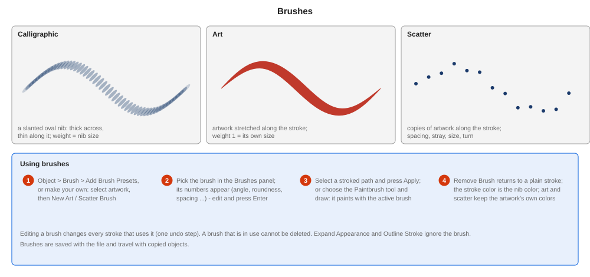

### Brushes

A brush changes how a stroke is drawn. Three kinds: **calligraphic** (a slanted oval nib: thick across, thin along it), **art**
(artwork stretched along the stroke) and **scatter** (copies of artwork along it).

1. *Object > Brush > Add Brush Presets* adds a few (Calligraphic 45, Flat Chisel, Felt Tip, Dots, Stars, Tapered), or select some
   artwork and press **New Art Brush** / **New Scatter Brush** in the Brushes panel (New Calligraphic Brush needs no selection).
2. Choose the brush in the **Brushes** drop-down; its numbers appear - the nib *Angle* and *Round* ness, or for scatter the
   *Space* between copies, *Stray* from the path, *Size* and *Turn* variation and whether copies *Follow path*. Edit a number and
   press Enter: every stroke that uses the brush changes.
3. Select a stroked path and press **Apply** (or *Object > Brush > Apply Brush*); or pick the **Paintbrush** tool and just draw.
4. **Remove** returns the selection to a plain stroke.

The stroke's weight is the nib size for a calligraphic brush; for art and scatter, weight 1 shows the artwork at its own size and 2
at twice that. Art and scatter brushes keep the artwork's own colors.

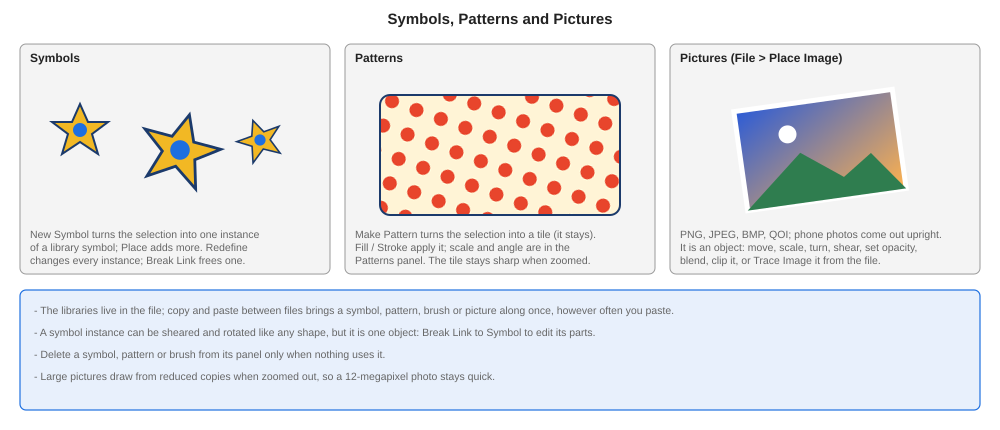

### Symbols

Select artwork and press **New Symbol** (Symbols panel or *Object > Symbol*): it becomes one *instance* of a symbol in the library.
**Place** adds another instance in the middle of the page; **Redefine** replaces the symbol's artwork with the current selection
and every instance changes; **Break Link** turns one instance back into ordinary objects. Instances move, scale, rotate and shear
like any object. A symbol can be deleted only when nothing uses it.

### Patterns

**Make Pattern** turns the selection into a repeating tile (the original stays). Select shapes, choose the pattern in the
**Patterns** panel and press **Fill** or **Stroke**. The *Scale* and *Angle* fields change the pattern of the selected shape.

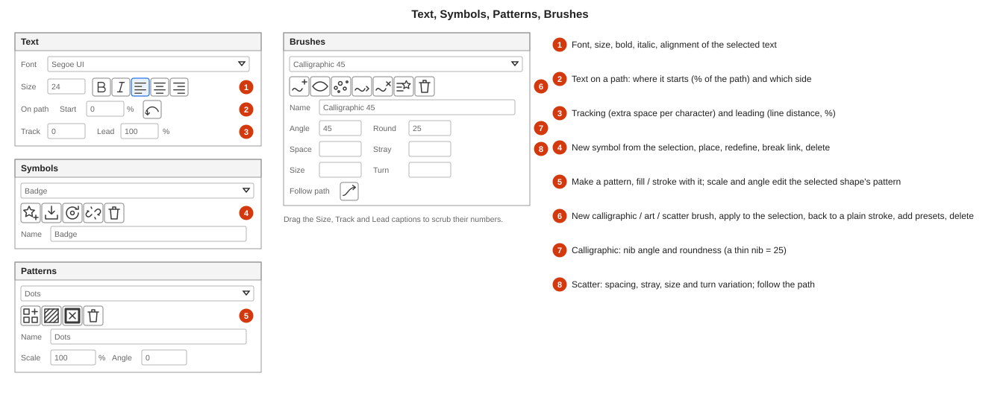

### Pictures

**File > Place Image** puts a PNG, JPEG, BMP or QOI file on the page (a picture larger than the page is scaled to fit; phone
photos come out the right way up). A picture is an object: move, scale, rotate, shear, set its opacity and blend mode, put it in a
layer or group, or use it inside a clipping mask. Pictures are saved *inside* the document. **File > Trace Image** converts a
picture file into vector shapes; its dialog sets the number of colors, the size traced, how small a speck may be, how smooth the
curves are and whether a white background is left out.

If a picture cannot be read you get the message "The image can't be loaded".

## 11. Layers, clipping masks and artboards

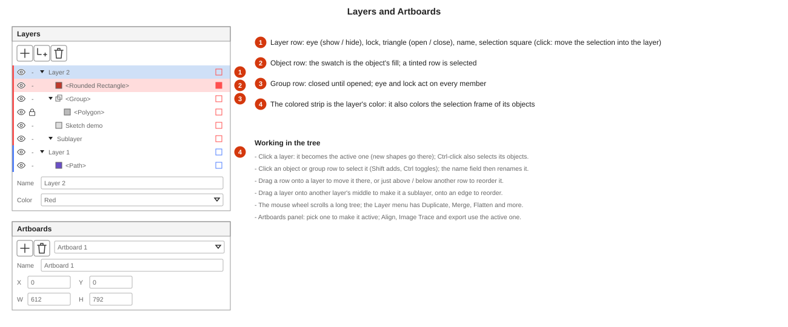

### Layers

The **Layers** panel is a tree: layers (which can contain sublayers), and inside each layer its objects - groups are one row that
opens to show their members - the front-most first. Every row has an **eye** (show / hide), a **lock**, and a **square** at the right
that is filled when the row is selected. A colored strip down the left edge is the layer's color: pick one of nine in the *Color*
box; the selection frame of objects in the layer is drawn in it.

- Click a layer to make it the **active layer** (new shapes go there). **Ctrl+click** also selects everything in it.
- Click an object or group row to select it (Shift adds, Ctrl toggles); the *Name* box then renames the object.
- **Drag** a row onto a layer to move it there, or between rows to reorder; drag a layer onto the middle of another to make it a
  sublayer.
- The buttons make a **new layer**, a **new sublayer** and **delete** the active layer. The mouse wheel scrolls a long list.
- The **Layer** menu adds: Duplicate, Bring Forward / Send Backward, **Merge Layer Down**, **Flatten Artwork** (everything into one
  layer), Show All, Hide Others, Lock Others, Unlock All, Select Objects in Layer, Expand / Collapse All.

### Clipping masks

A **clipping mask** hides everything of some artwork that lies outside a shape - the way a window frame shows only part of the view.
Nothing is deleted: the hidden parts are still there, and releasing the mask brings them back.

**Why use one**

- **Crop a picture or drawing to a shape**: a photo in a circle, a badge or a speech bubble, a pattern inside a button.
- **Put pictures, stripes or gradients inside letters**: make the text the mask.
- **Trim what spills over**: a background pattern, a stroke that runs past a card, a drawing that must stay inside an artboard.
- **Shape a block of artwork without destroying it**: unlike Pathfinder *Intersect*, which really cuts the shapes, a mask can be
  moved, resized or released later, and the original artwork stays intact.

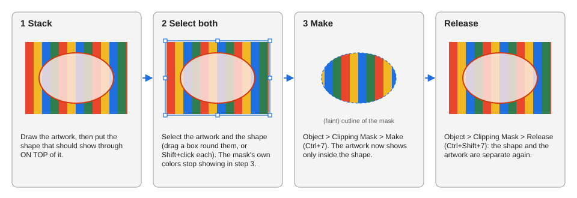

**How to make one**

1. Draw (or place) the artwork that should be cut: shapes, a picture, text, other groups - as many objects as you like.
2. Draw the shape that should *show through* and bring it to the **top** of the artwork (*Arrange > Bring to Front*, or
   draw it last). Position it over the part you want to keep.
3. Select the artwork **and** the shape (drag a box round them, or Shift+click each).
4. Choose *Object > Clipping Mask > Make* (**Ctrl+7**). The artwork now shows only inside the shape, and the selection becomes one group.

To take it apart again, select the masked group and choose *Object > Clipping Mask > Release* (**Ctrl+Shift+7**): the shape and the
artwork are separate objects again, exactly as they were.

**Examples**

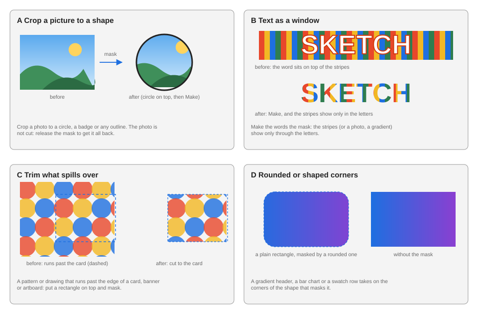

- **A - a picture in a shape.** Place a picture (*File > Place Image*), draw a circle over the part you want, select both, press
  **Ctrl+7**. To show a different part of the picture afterwards, Ctrl+click the picture inside the group and move it; the circle
  stays put. Give the circle a stroke *before* masking if you want a frame: since the mask's own stroke is not drawn, copy the circle
  first (**Ctrl+C**, then **Ctrl+Shift+V** pastes it in place) and use the copy, with no fill and a stroke, as a frame on top.
- **B - text as a window.** Type the words with the Text tool (a heavy, wide font works best), put them on top of a picture, a
  gradient or a set of stripes, select both and make the mask. The letters show the artwork through them. To change the words later, release
  the mask, edit the text, and make the mask again.
- **C - trimming overflow.** Draw a pattern or a drawing that is larger than the area it is meant for, then draw a rectangle (or
  any shape) exactly over the area you want to keep and make the mask. The same trick tidies the edge of a design that must stay
  inside an artboard: use a rectangle the size of the artboard.
- **D - shaped corners.** Cover a gradient header, a row of swatches or a bar chart with a rounded rectangle and mask: the artwork
  takes on its corners. To change the corners later, release the mask, adjust the rounded rectangle and make the mask again.

**What to know**

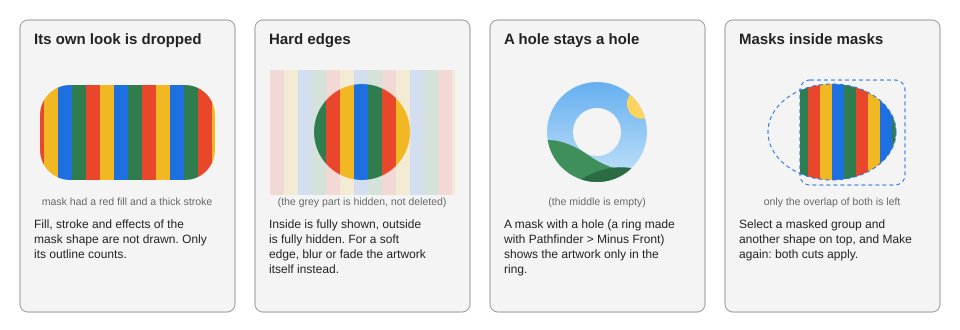

- **The mask is the top object.** Only the object that is on top of the others in the selection is the mask; the rest is cut by it.
  To mask with *several* shapes, join them into one first (*Object > Pathfinder > Unite*, or Minus Front to cut a hole in one).
- **The mask needs an area.** A straight line or a single point cannot be a mask. An open path is treated as if closed with a
  straight line, as it would be when filled.
- **Its fill, stroke and effects are not drawn.** Only the outline counts, so the mask can have any color. If you want a visible
  frame, put a copy of the shape on top as a separate object (see example A).
- **Edges are hard.** A point is either shown or hidden; there is no soft or fading mask. For a fading edge, put a gradient or a
  blur on the artwork itself.
- **Holes are respected.** If the mask shape has a hole (a ring from Minus Front, or text with an *O* or *A*), the artwork is cut out there too.
- **Masks nest.** Select a masked group together with another shape that is on top and make the mask again: both cuts apply, and
  only the overlap remains. Groups, layers and clipping masks all work together; a mask can sit in any layer.
- **Working inside a masked group.** Click selects the whole group, which moves, rotates and scales mask and artwork together.
  **Ctrl+click** picks one object inside (the artwork or the mask shape), and the Layers panel opens the group so you can pick any
  member by its row: the mask is the top row. Move the artwork under the mask to choose which part shows, or pick the mask shape and
  reshape it to change the window.
- **Opacity and blend mode** set on the masked group apply to the cut result as one piece.
- **Saving and exporting.** *File > Save* keeps the mask. *Export As Image* and *Export As PDF* apply the cut (the PDF keeps it as a
  real clipping path, so the artwork stays vector). Other programs that open the saved SVG show the artwork uncut with the mask
  shape on top, because the mask is stored as a sketch-specific marker; export first if you need the cut result elsewhere.
- **Undo** (**Ctrl+Z**) undoes Make and Release like any other step.

### Artboards

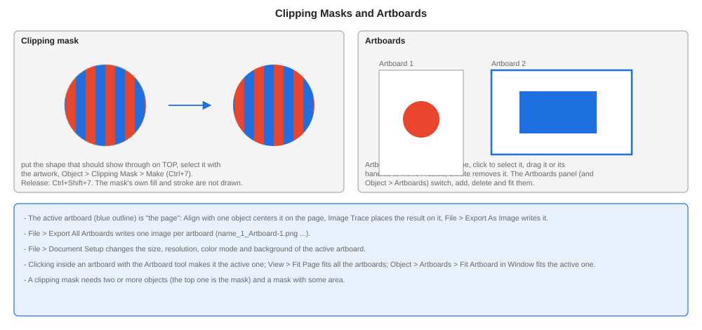

**Artboards** are named pages on the canvas. Use the **Artboard** tool: drag to make one, click one to select it, drag it or its
handles to move or resize it, **Delete** removes it. The **Artboards** panel adds, deletes, names and positions them, and *Object >
Artboards* switches between them and fits one in the window. The **active** artboard (blue outline when there are several) is
"the page": *Align* with one object uses it, Trace Image places its result on it, and *File > Export As Image* writes it.
*File > Export All Artboards* writes one image per artboard.

## 12. Rulers, guides, grid and snapping

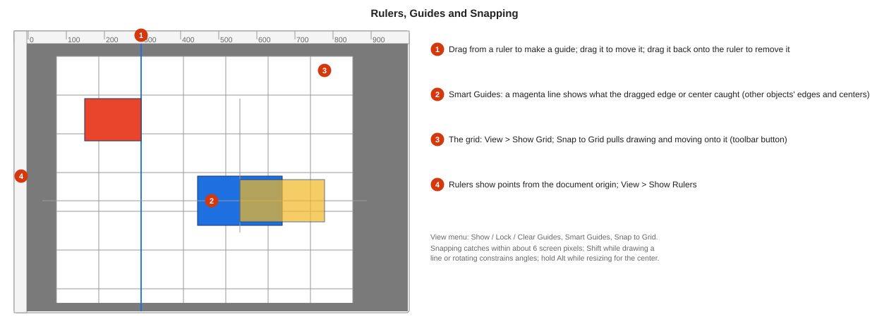

Drag from a **ruler** to make a **guide**; drag a guide to move it, or back onto the ruler to remove it. Objects you draw, move or
resize **snap** (within about six screen pixels) to guides, the grid (*View > Show Grid*, *Snap to Grid*) and, with **Smart Guides**,
to the edges and centers of other objects - a magenta line shows what it caught. *View > Lock Guides* and *Clear Guides* are there
too. **Ctrl+R** shows or hides the rulers, **Ctrl+'** the grid, **Ctrl+;** the guides.

## 13. Files and export

| Command | Does |
|---|---|
| File > New (Ctrl+N) | A new document: pick a preset, size, color mode and background. |
| File > Open (Ctrl+O), Open Recent | Opens `.svg`, `.svgz` (compressed) or `.skb`; the kind is recognized from the file itself. Other programs' SVG files open with the common subset (shapes, groups, gradients, symbols and `<use>`, clip paths, simple filters, embedded pictures). |
| File > Save (Ctrl+S), Save As | `.svg` (readable by other programs; everything sketch needs is kept in extra attributes), `.svgz`, or `.skb` (the native binary format: smaller and several times faster for big drawings). |
| File > Export As Image | PNG, BMP or QOI of the active artboard. |
| File > Export All Artboards | One image per artboard. |
| File > Export As PDF | One PDF page per artboard, artwork kept as vectors (text as outlines). |
| File > Document Setup | Page size, resolution (ppi), color mode and background of the active artboard. |
| File > Place Image / Trace Image | Section 10. |

Closing the window (or New / Open) asks whether to save unsaved changes. Copy and paste carry symbols, patterns, brushes and
pictures along with the objects.

## 14. Keyboard and mouse reference

| Keys | Action |
|---|---|
| Ctrl+N, Ctrl+O, Ctrl+S, Ctrl+Shift+S | New, Open, Save, Save As |
| Ctrl+Z, Ctrl+Y | Undo, Redo |
| Ctrl+X, Ctrl+C, Ctrl+V, Ctrl+Shift+V | Cut, Copy, Paste, Paste in place |
| Ctrl+D, Delete | Duplicate, Delete |
| Ctrl+A, Ctrl+Shift+A, Esc | Select all, Deselect, Cancel / deselect |
| Ctrl+G, Ctrl+Shift+G | Group, Ungroup |
| Ctrl+2, Ctrl+3 | Lock, Hide |
| Ctrl+] / Ctrl+[ (+ Shift) | Bring forward / Send backward (to front / to back) |
| Ctrl+7, Ctrl+Shift+7 | Make / Release Clipping Mask |
| Ctrl+Shift+D, Ctrl+Shift+B | Transform Again, Reset Bounding Box |
| Ctrl++, Ctrl+-, Ctrl+0, Ctrl+1 | Zoom in, out, Fit Page, Actual Size |
| Ctrl+R, Ctrl+', Ctrl+Shift+', Ctrl+; | Rulers, Grid, Snap to Grid, Guides |
| Arrow keys (+ Shift) | Nudge 1 pt (10 pt) |
| Up / Down while dragging | Sides, points, corner radius, arc sweep; eraser size |
| Ctrl+Up / Ctrl+Down while typing | Text size |

| Mouse | Action |
|---|---|
| Wheel, Shift+wheel, Ctrl+wheel | Scroll vertically, scroll sideways, zoom |
| Middle or right button drag, Hand tool | Pan |
| Shift (while dragging) | Constrain: axis, proportions, 15 / 45 degree steps |
| Alt (while resizing) / at release of Rotate, Scale, Reflect | From the center / make a copy |
| Alt+Shift on a handle | Shear (edge) or perspective warp (corner) |
| Ctrl+click | Pick one object out of a group; toggle in the Layers panel |
| Drag a panel caption (X, W, Angle, Size, Track, Lead, Weight ...) | Scrub the number (Shift = fine, Ctrl+Shift = finer) |

## 15. Not there yet

So that nothing surprises you:

- **Export As PDF** keeps the artwork as vectors; shadows, glows and blurs become pictures, and gradients that repeat or reflect are written padded.
- Pattern brushes (tiles for corners and sides), editing the artwork of a brush, symbol or pattern in place (make a new one with
  the selection instead), and raster effects on a placed picture when saving to SVG are not available.
- Text on a path copies the path: editing the path later does not move the text (release it and make it again).
- Complex SVG filters are ignored when opening files; pictures must be embedded (data URIs) to open from other programs' SVG.
- Rulers always measure from the first artboard's corner, not the active one.
